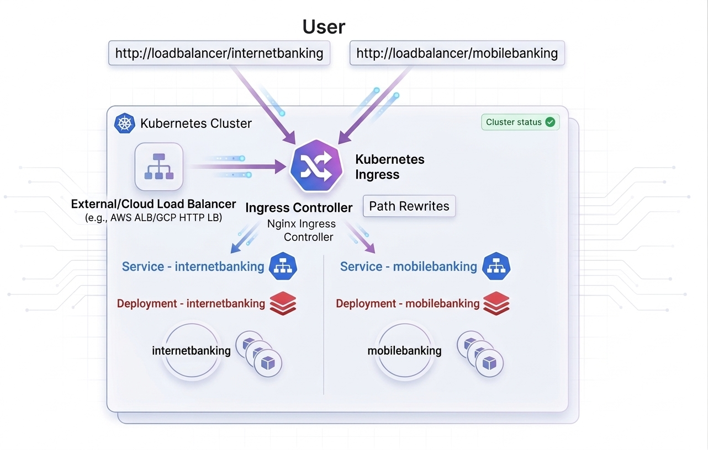
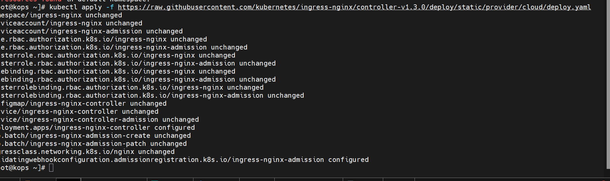
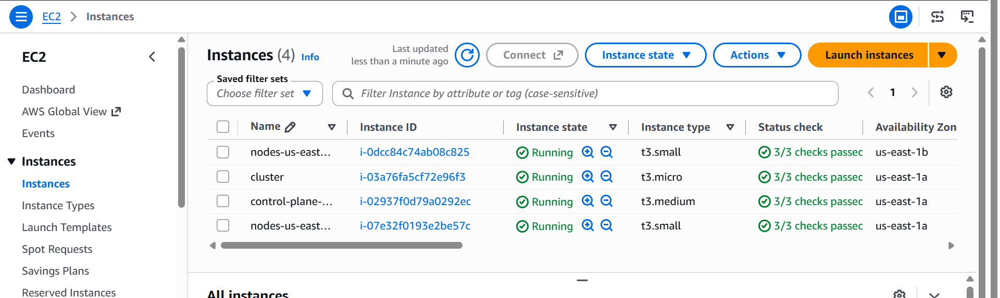
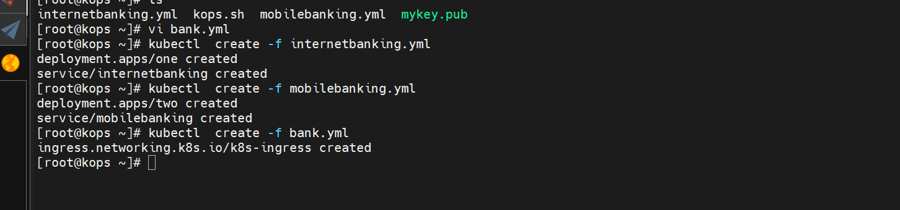
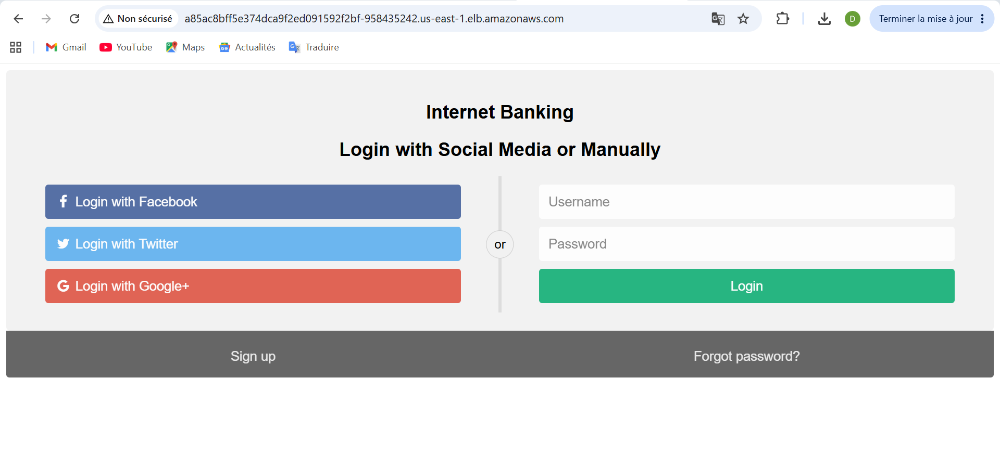
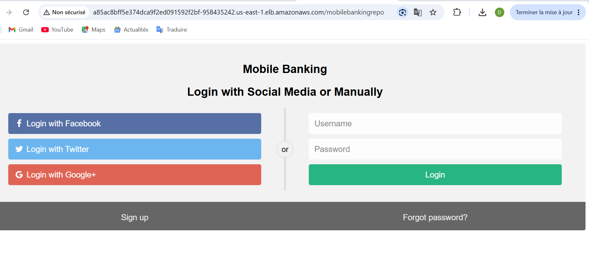

# Kubernetes Ingress Routing with NGINX (Banking Platform)

This project demonstrates **path-based HTTP routing** using the **NGINX Ingress Controller** on a Kubernetes cluster running on **AWS**.

The objective is to expose two independent banking applications — **Internet Banking** and **Mobile Banking** — through a **single external Load Balancer**, using Kubernetes Ingress rules and URL path-based routing.

---

## 🏗️ Architecture Overview

### Traffic Flow

The traffic follows this architecture:

```text
                         Internet
                            │
                            ▼
                 ┌─────────────────────┐
                 │   AWS Load Balancer  │
                 │   External Endpoint  │
                 └──────────┬──────────┘
                            │
                            ▼
                 ┌─────────────────────┐
                 │  NGINX Ingress      │
                 │     Controller      │
                 └──────────┬──────────┘
                            │
             ┌──────────────┴──────────────┐
             │                             │
             ▼                             ▼
   /internetbanking                 /mobilebanking
             │                             │
             ▼                             ▼
   ┌─────────────────┐           ┌─────────────────┐
   │ Internet Banking│           │ Mobile Banking  │
   │    Service      │           │    Service      │
   └────────┬────────┘           └────────┬────────┘
            │                             │
            ▼                             ▼
      Application Pods              Application Pods
```

### Routing Logic

Users access the applications through different URL paths:

```text
http://<LOAD_BALANCER_URL>/internetbanking
http://<LOAD_BALANCER_URL>/mobilebanking
```

The NGINX Ingress Controller analyzes the requested path and forwards the request to the corresponding Kubernetes Service.

| URL Path           | Kubernetes Service | Application      |
| ------------------ | ------------------ | ---------------- |
| `/internetbanking` | `internetbanking`  | Internet Banking |
| `/mobilebanking`   | `mobilebanking`    | Mobile Banking   |

The Ingress configuration can also use **path rewriting** so that the backend application receives the URL format it expects.

---

# 🛠️ Project Structure

```text
.
├── Architecture.jpg          # Architecture overview diagram
├── App-ib-on-LB.png          # Internet Banking verification screenshot
├── App-MB-onLB.png           # Mobile Banking verification screenshot
├── Ingress-install.png       # NGINX Ingress installation screenshot
├── ec2s-instaces.png         # AWS EC2 cluster instances screenshot
├── pode-created.png          # Kubernetes pods verification screenshot
├── ingress.yml               # Ingress routing and rewrite configuration
├── internetbanking.yml       # Internet Banking Deployment & Service
├── mobilebanking.yml         # Mobile Banking Deployment & Service
└── install.txt               # Installation commands and troubleshooting notes
```

---

# 🚀 Deployment Guide

## Prerequisites

Before starting, make sure you have:

* A running Kubernetes cluster on AWS
* Kubernetes nodes configured using **kOps** or **kubeadm**
* `kubectl` installed and configured
* Administrative access to the Kubernetes cluster
* Internet connectivity from the cluster nodes
* AWS permissions allowing the Kubernetes Load Balancer to be provisioned

Verify the cluster:

```bash
kubectl get nodes
```

Expected result:

```text
NAME              STATUS   ROLES
master-node       Ready    control-plane
worker-node-1     Ready    <none>
worker-node-2     Ready    <none>
```

---

# 1. Deploy Internet Banking

Apply the Internet Banking Deployment and Service:

```bash
kubectl apply -f internetbanking.yml
```

Verify the resources:

```bash
kubectl get deployment
kubectl get pods -o wide
kubectl get svc
```

---

# 2. Deploy Mobile Banking

Apply the Mobile Banking Deployment and Service:

```bash
kubectl apply -f mobilebanking.yml
```

Verify:

```bash
kubectl get deployment
kubectl get pods -o wide
kubectl get svc
```

You should see both applications running:

```text
internetbanking
mobilebanking
```

---

# 3. Install NGINX Ingress Controller

Install the official NGINX Ingress Controller for a cloud environment:

```bash
kubectl apply -f https://raw.githubusercontent.com/kubernetes/ingress-nginx/main/deploy/static/provider/cloud/deploy.yaml
```

Check the installation:

```bash
kubectl get pods -n ingress-nginx
```

The controller should eventually reach:

```text
STATUS: Running
```

Check the Service:

```bash
kubectl get svc -n ingress-nginx
```

On AWS, the LoadBalancer Service can trigger the provisioning of an external AWS Load Balancer.

Wait until an external address is available:

```bash
kubectl get svc -n ingress-nginx -w
```

---

# 4. Deploy the Ingress Configuration

Apply the Ingress resource:

```bash
kubectl apply -f ingress.yml
```

Verify:

```bash
kubectl get ingress
```

For more detailed information:

```bash
kubectl describe ingress
```

You can also verify the IngressClass:

```bash
kubectl get ingressclass
```

The project should use the NGINX Ingress Controller, for example:

```text
NAME    CONTROLLER
nginx   k8s.io/ingress-nginx
```

---

# 🔀 5. Path-Based Routing

The Ingress resource defines routing rules similar to:

```text
                     AWS Load Balancer
                            │
                            ▼
                  NGINX Ingress Controller
                            │
              ┌─────────────┴─────────────┐
              │                           │
              ▼                           ▼
       /internetbanking            /mobilebanking
              │                           │
              ▼                           ▼
     internetbanking Service      mobilebanking Service
              │                           │
              ▼                           ▼
       Internet Banking           Mobile Banking
            Pods                       Pods
```

Therefore:

### Internet Banking

```text
http://<LOAD_BALANCER_URL>/internetbanking
```

is routed to:

```text
internetbanking Service
```

### Mobile Banking

```text
http://<LOAD_BALANCER_URL>/mobilebanking
```

is routed to:

```text
mobilebanking Service
```

---

# 🔍 Verification & Testing

## Check Nodes

```bash
kubectl get nodes
```

## Check Pods

```bash
kubectl get pods -o wide
```

## Check Services

```bash
kubectl get svc
```

## Check Ingress Controller

```bash
kubectl get pods -n ingress-nginx
```

## Check Ingress Service

```bash
kubectl get svc -n ingress-nginx
```

## Check Ingress

```bash
kubectl get ingress
```

## Detailed Ingress Information

```bash
kubectl describe ingress
```

---

# 🌐 Application Testing

Once the AWS Load Balancer receives an external hostname, test the applications.

### Internet Banking

```text
http://<LOAD_BALANCER_URL>/internetbanking
```

Expected result:

```text
Internet Banking Application
```

### Mobile Banking

```text
http://<LOAD_BALANCER_URL>/mobilebanking
```

Expected result:

```text
Mobile Banking Application
```

The two applications are therefore accessible through the **same external Load Balancer**, while NGINX determines which Kubernetes Service should receive the request.

---

# 🧪 Troubleshooting

## Ingress has no external address

Check the NGINX Service:

```bash
kubectl get svc -n ingress-nginx
```

Check the controller:

```bash
kubectl get pods -n ingress-nginx
```

Check controller logs:

```bash
kubectl logs -n ingress-nginx \
  deployment/ingress-nginx-controller
```

---

## Check the IngressClass

```bash
kubectl get ingressclass
```

The expected controller is:

```text
k8s.io/ingress-nginx
```

If your Ingress uses:

```yaml
ingressClassName: nginx
```

make sure an `IngressClass` named `nginx` exists.

---

## Check the backend Services

```bash
kubectl get svc
```

Verify that the Services referenced by `ingress.yml` actually exist.

For example:

```bash
kubectl get svc internetbanking
kubectl get svc mobilebanking
```

---

## Check Service Endpoints

```bash
kubectl get endpoints
```

or:

```bash
kubectl get endpointslices
```

The Services must have endpoints corresponding to running application Pods.

---

## Check Application Pods

```bash
kubectl get pods -o wide
```

If a Pod is not running:

```bash
kubectl describe pod <POD_NAME>
```

Check its logs:

```bash
kubectl logs <POD_NAME>
```

---

# 🔐 HTTPS Considerations

This project primarily demonstrates **HTTP path-based routing**.

For a production environment, HTTPS should be configured using:

* A domain name
* TLS certificates
* Kubernetes TLS configuration
* AWS DNS services such as Route 53
* Optionally AWS Certificate Manager depending on the architecture

A raw AWS Load Balancer hostname may not have a certificate matching that hostname when HTTPS is configured at the application layer, which can result in browser certificate warnings.

---

# 🧹 Cleanup

Delete the Ingress:

```bash
kubectl delete -f ingress.yml
```

Delete Internet Banking:

```bash
kubectl delete -f internetbanking.yml
```

Delete Mobile Banking:

```bash
kubectl delete -f mobilebanking.yml
```

Delete the NGINX Ingress Controller:

```bash
kubectl delete -f https://raw.githubusercontent.com/kubernetes/ingress-nginx/main/deploy/static/provider/cloud/deploy.yaml
```

Verify that the resources have been removed:

```bash
kubectl get pods
kubectl get svc
kubectl get ingress
```

---

# 📸 Project Screenshots

### Architecture



### NGINX Ingress Installation



### AWS EC2 Kubernetes Cluster



### Kubernetes Pods



### Internet Banking Application



### Mobile Banking Application



---

# 🎯 Project Objectives

This project demonstrates the following Kubernetes concepts:

* Kubernetes Deployments
* Kubernetes Services
* NGINX Ingress Controller
* Kubernetes Ingress resources
* Path-based routing
* URL path rewriting
* Microservice exposure
* AWS Load Balancer integration
* Kubernetes networking
* Application troubleshooting
* Cloud-native architecture

---

# 🚀 Future Improvements

Possible improvements include:

* HTTPS/TLS with a valid domain
* AWS Certificate Manager integration
* Route 53 DNS configuration
* Multiple environments: Dev / Staging / Production
* Helm-based deployment
* Argo CD GitOps deployment
* Prometheus and Grafana monitoring
* Centralized logging
* Network Policies
* AWS WAF integration
* Automated CI/CD pipelines

---

# 🧠 Key Kubernetes Concepts Learned

This project provides practical experience with:

```text
Kubernetes
    │
    ├── Deployment
    │
    ├── Pod
    │
    ├── Service
    │
    ├── Ingress
    │
    ├── IngressClass
    │
    ├── NGINX Ingress Controller
    │
    └── Load Balancer
```

The main concept demonstrated is:

```text
External Request
       │
       ▼
AWS Load Balancer
       │
       ▼
NGINX Ingress Controller
       │
       ├── /internetbanking ──► Internet Banking Service
       │                              │
       │                              ▼
       │                         Application Pods
       │
       └── /mobilebanking ────► Mobile Banking Service
                                      │
                                      ▼
                                 Application Pods
```

---

# 👨‍💻 Author

**Boubacar Djibrilla**

Software Engineering Graduate
AWS & DevOps / Cloud Computing

GitHub: `boubacardjibrilla`

---

## 🏷️ Technologies

**AWS · Kubernetes · kOps · NGINX · Ingress · Docker · Linux · Networking · DevOps · Cloud Computing**
